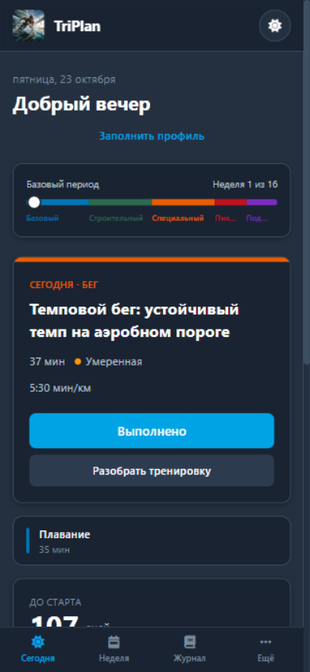
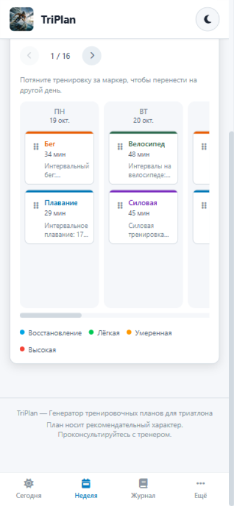
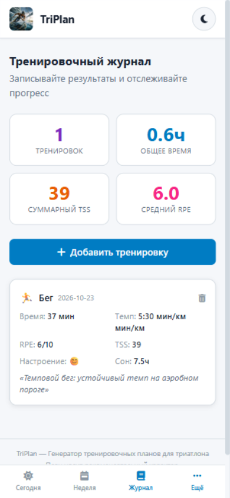

# TriPlan

Тренировочный план триатлета, который открывается с экрана телефона каждый день.

Рабочая версия: [vyacheslavpalekha-maker.github.io/triplan](https://vyacheslavpalekha-maker.github.io/triplan/)

<p align="center">
  <a href="https://vyacheslavpalekha-maker.github.io/triplan/">
    
  </a>
  
  
</p>

## Задача

Спортсмену, который готовится к старту без ежедневного созвона с тренером, нужен один экран: что делать сегодня, как выглядит неделя и где зафиксировать выполненную работу. План должен жить на телефоне и открываться без отдельного магазина приложений.

## Решение

Клиентское веб-приложение. Его добавляют на экран «Домой», после этого оно открывается как обычная программа. Профиль, дата старта, журнал и переносы тренировок хранятся на этом телефоне.

В приложении есть:

- экран «Сегодня»: ближайшая сессия, дни до старта, готовность и значки;
- доска недели: семь дней, перенос тренировки на другой день;
- журнал выполненных сессий;
- профиль: пульсовые и темповые зоны, дистанция, дата старта;
- ползунок длины плана от 4 до 52 недель, который сам ставится по дате соревнования;
- разделы питания и силовой работы.

## Стек

React, TypeScript, Vite, Tailwind CSS. Приложение собрано в Cursor и опубликовано на GitHub Pages.

## Локальный запуск

```bash
npm install
npm run dev
```

Приложение откроется на http://localhost:3000/
